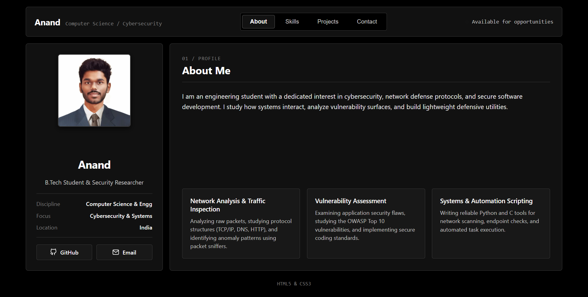

# Ex01 Portfolio
## Date:

## AIM
To create a Portfolio using HTML and CSS.

## ALGORITHM
### STEP 1
Create an HTML file (index.html)

### STEP 2
Create a CSS file (style.css)

### STEP 3
Include a navigation bar with links to different sections.

### STEP 4
Add structured sections for introduction, about, projects, and contact details.

### STEP 5
Define global styles for fonts, colors, and layout.

### STEP 6
Style the header, navigation bar, and sections.

### STEP 7
Use Flexbox or CSS Grid for layout design.

### STEP 8
Add hover effects and transitions for interactivity.

### STEP 9
Add Images and Media.

### STEP 10
Use optimized images for a professional look.

### STEP 11
Open the HTML file in a browser to check layout and functionality.

### STEP 12
Fix styling issues and refine content placement.

### STEP 13
Deploy the Portfolio.

### STEP 14
Upload to GitHub Pages for free hosting.

## PROGRAM

### index.html
```html
<!DOCTYPE html>
<html lang="en">
<head>
  <meta charset="UTF-8">
  <meta name="viewport" content="width=device-width, initial-scale=1.0">
  <title>Anand | Portfolio</title>
  <link rel="stylesheet" href="style.css">
</head>
<body>
  <div class="app-layout">
    <header class="app-header">
      <div class="brand">
        <span class="brand-name">Anand</span>
        <span class="brand-role">Computer Science / Cybersecurity</span>
      </div>
      <nav class="tab-nav">
        <button class="tab-btn active" data-tab="about">About</button>
        <button class="tab-btn" data-tab="skills">Skills</button>
        <button class="tab-btn" data-tab="projects">Projects</button>
        <button class="tab-btn" data-tab="contact">Contact</button>
      </nav>
      <div class="header-status">
        <span class="status-indicator"></span> Available for opportunities
      </div>
    </header>

    <main class="app-main">
      <aside class="profile-panel">
        <div class="profile-image-container">
          
        </div>
        <div class="profile-meta">
          <h1 class="profile-title">Anand</h1>
          <p class="profile-tagline">B.Tech Student &amp; Security Researcher</p>
          <div class="profile-details">
            <div class="detail-row">
              <span class="detail-label">Discipline</span>
              <span class="detail-value">Computer Science &amp; Engg</span>
            </div>
            <div class="detail-row">
              <span class="detail-label">Focus</span>
              <span class="detail-value">Cybersecurity &amp; Systems</span>
            </div>
            <div class="detail-row">
              <span class="detail-label">Location</span>
              <span class="detail-value">India</span>
            </div>
          </div>
          <div class="profile-actions">
            <a href="https://github.com/AnandK28" target="_blank" class="link-btn">GitHub</a>
            <a href="mailto:anand@example.com" class="link-btn">Email</a>
          </div>
        </div>
      </aside>

      <section class="content-panel">
        <article class="tab-pane active" id="pane-about">
          <div class="pane-header">
            <span class="pane-tag">01 / Profile</span>
            <h2 class="pane-title">About Me</h2>
          </div>
          <div class="about-overview">
            <p>I am an engineering student with a dedicated interest in cybersecurity, network defense protocols, and secure software development.</p>
          </div>
          <div class="focus-grid">
            <div class="focus-box">
              <h3>Network Analysis &amp; Traffic Inspection</h3>
              <p>Analyzing raw packets, studying protocol structures (TCP/IP, DNS, HTTP), and identifying anomaly patterns.</p>
            </div>
            <div class="focus-box">
              <h3>Vulnerability Assessment</h3>
              <p>Examining application security flaws, studying the OWASP Top 10 vulnerabilities, and implementing secure coding standards.</p>
            </div>
            <div class="focus-box">
              <h3>Systems &amp; Automation Scripting</h3>
              <p>Writing reliable Python and C tools for network scanning, endpoint checks, and automated task execution.</p>
            </div>
          </div>
        </article>

        <article class="tab-pane" id="pane-skills">
          <div class="pane-header">
            <span class="pane-tag">02 / Technical Stack</span>
            <h2 class="pane-title">Skills &amp; Technologies</h2>
          </div>
          <div class="skills-columns">
            <div class="skill-column">
              <h3 class="skill-col-title">Cybersecurity</h3>
              <div class="tag-cloud">
                <span class="tag">Network Security</span>
                <span class="tag">OWASP Top 10</span>
                <span class="tag">Wireshark</span>
                <span class="tag">Nmap</span>
                <span class="tag">Linux CLI</span>
              </div>
            </div>
            <div class="skill-column">
              <h3 class="skill-col-title">Programming</h3>
              <div class="tag-cloud">
                <span class="tag">Python</span>
                <span class="tag">C</span>
                <span class="tag">C++</span>
                <span class="tag">JavaScript</span>
                <span class="tag">Bash</span>
              </div>
            </div>
            <div class="skill-column">
              <h3 class="skill-col-title">Tools &amp; Web</h3>
              <div class="tag-cloud">
                <span class="tag">HTML5</span>
                <span class="tag">CSS3</span>
                <span class="tag">Git</span>
                <span class="tag">GitHub</span>
                <span class="tag">VS Code</span>
              </div>
            </div>
          </div>
        </article>

        <article class="tab-pane" id="pane-projects">
          <div class="pane-header">
            <span class="pane-tag">03 / Projects</span>
            <h2 class="pane-title">Selected Projects</h2>
          </div>
          <div class="projects-display">
            <div class="compact-project">
              <h4>Network Packet Analyzer</h4>
              <p>Python-based packet inspection tool parsing headers and logging protocol metrics.</p>
              <div class="proj-badges">
                <span>Python</span>
                <span>Scapy</span>
              </div>
            </div>
            <div class="compact-project">
              <h4>Vulnerability Scanner CLI</h4>
              <p>Automated command-line scanner checking target endpoints for header vulnerabilities and open flags.</p>
              <div class="proj-badges">
                <span>Python</span>
                <span>Requests</span>
              </div>
            </div>
            <div class="compact-project">
              <h4>Single-Screen Minimal Portfolio</h4>
              <p>Zero-scroll high-contrast dashboard portfolio coded in pure semantic HTML &amp; CSS.</p>
              <div class="proj-badges">
                <span>HTML5</span>
                <span>CSS3</span>
              </div>
            </div>
          </div>
        </article>

        <article class="tab-pane" id="pane-contact">
          <div class="pane-header">
            <span class="pane-tag">04 / Connect</span>
            <h2 class="pane-title">Get In Touch</h2>
          </div>
          <div class="contact-compact-layout">
            <div class="contact-card-info">
              <h3>Let's talk</h3>
              <p>Feel free to reach out regarding cybersecurity internships, software engineering roles, or tech discussions.</p>
              <div class="contact-quick-links">
                <a href="mailto:anand@example.com" class="direct-link">
                  <span class="label">Email</span>
                  <span class="val">anand@example.com</span>
                </a>
                <a href="https://github.com/AnandK28" target="_blank" class="direct-link">
                  <span class="label">GitHub</span>
                  <span class="val">github.com/AnandK28</span>
                </a>
              </div>
            </div>
            <form class="compact-form" onsubmit="event.preventDefault(); alert('Message noted.');">
              <div class="input-field">
                <label for="name">Name</label>
                <input type="text" id="name" placeholder="Your Name" required>
              </div>
              <div class="input-field">
                <label for="email">Email</label>
                <input type="email" id="email" placeholder="Your Email" required>
              </div>
              <div class="input-field">
                <label for="msg">Message</label>
                <textarea id="msg" rows="3" placeholder="Your message..." required></textarea>
              </div>
              <button type="submit" class="submit-btn">Send Message</button>
            </form>
          </div>
        </article>
      </section>
    </main>

    <footer class="app-footer">
      <span>HTML5 &amp; CSS3</span>
    </footer>
  </div>
  <script src="script.js"></script>
</body>
</html>
```

### style.css
```css
:root {
  --bg-app: #000000;
  --bg-panel: #111111;
  --bg-surface: #181818;
  --border-light: #333333;
  --text-pure: #ffffff;
  --text-high: #ededed;
  --text-medium: #c2c2c2;
  --text-dim: #888888;
  --font-sans: -apple-system, BlinkMacSystemFont, "Segoe UI", Roboto, sans-serif;
  --font-mono: ui-monospace, SFMono-Regular, Menlo, Monaco, monospace;
}

* {
  margin: 0;
  padding: 0;
  box-sizing: border-box;
}

html, body {
  width: 100%;
  height: 100vh;
  overflow: hidden;
  background-color: var(--bg-app);
  color: var(--text-high);
  font-family: var(--font-sans);
}

a {
  color: inherit;
  text-decoration: none;
}

.app-layout {
  display: flex;
  flex-direction: column;
  height: 100vh;
  max-width: 1300px;
  margin: 0 auto;
  padding: 1rem 1.5rem;
  gap: 1rem;
}

.app-header {
  flex-shrink: 0;
  display: flex;
  align-items: center;
  justify-content: space-between;
  padding: 0.85rem 1.25rem;
  background-color: var(--bg-panel);
  border: 1px solid var(--border-light);
  border-radius: 6px;
}

.brand {
  display: flex;
  align-items: baseline;
  gap: 0.75rem;
}

.brand-name {
  font-size: 1.25rem;
  font-weight: 700;
  color: var(--text-pure);
}

.brand-role {
  font-size: 0.8rem;
  color: var(--text-dim);
  font-family: var(--font-mono);
}

.tab-nav {
  display: flex;
  gap: 0.4rem;
  background-color: var(--bg-app);
  padding: 0.25rem;
  border-radius: 4px;
  border: 1px solid var(--border-light);
}

.tab-btn {
  background: transparent;
  border: 1px solid transparent;
  color: var(--text-medium);
  padding: 0.45rem 1.1rem;
  font-size: 0.85rem;
  font-weight: 500;
  cursor: pointer;
  border-radius: 4px;
}

.tab-btn:hover {
  color: var(--text-pure);
  background-color: var(--bg-surface);
}

.tab-btn.active {
  background-color: var(--text-pure);
  color: var(--bg-app);
  font-weight: 600;
}

.header-status {
  display: flex;
  align-items: center;
  gap: 0.5rem;
  font-size: 0.8rem;
  color: var(--text-medium);
  font-family: var(--font-mono);
}

.status-indicator {
  width: 8px;
  height: 8px;
  background-color: var(--text-pure);
  border-radius: 50%;
}

.app-main {
  flex: 1;
  display: grid;
  grid-template-columns: 320px 1fr;
  gap: 1rem;
  min-height: 0;
}

.profile-panel {
  background-color: var(--bg-panel);
  border: 1px solid var(--border-light);
  border-radius: 6px;
  padding: 1.5rem;
  display: flex;
  flex-direction: column;
  align-items: center;
  justify-content: space-between;
  text-align: center;
}

.profile-image-container {
  width: 170px;
  height: 170px;
  border-radius: 6px;
  overflow: hidden;
  border: 2px solid var(--border-light);
  background-color: var(--bg-surface);
  flex-shrink: 0;
}

.profile-photo {
  width: 100%;
  height: 100%;
  object-fit: cover;
  display: block;
}

.profile-meta {
  width: 100%;
  display: flex;
  flex-direction: column;
  gap: 1rem;
}

.profile-title {
  font-size: 1.6rem;
  font-weight: 700;
  color: var(--text-pure);
}

.profile-tagline {
  font-size: 0.88rem;
  color: var(--text-medium);
}

.profile-details {
  border-top: 1px solid var(--border-light);
  border-bottom: 1px solid var(--border-light);
  padding: 0.9rem 0;
  display: flex;
  flex-direction: column;
  gap: 0.6rem;
  text-align: left;
}

.detail-row {
  display: flex;
  justify-content: space-between;
  font-size: 0.82rem;
}

.detail-label {
  color: var(--text-dim);
}

.detail-value {
  color: var(--text-pure);
  font-weight: 500;
}

.profile-actions {
  display: flex;
  gap: 0.6rem;
  width: 100%;
}

.link-btn {
  flex: 1;
  display: inline-flex;
  align-items: center;
  justify-content: center;
  gap: 0.5rem;
  padding: 0.55rem 0.5rem;
  font-size: 0.82rem;
  font-weight: 600;
  background-color: var(--bg-surface);
  border: 1px solid var(--border-light);
  color: var(--text-pure);
  border-radius: 4px;
}

.link-btn:hover {
  background-color: var(--text-pure);
  color: var(--bg-app);
}

.content-panel {
  background-color: var(--bg-panel);
  border: 1px solid var(--border-light);
  border-radius: 6px;
  padding: 1.75rem;
  position: relative;
  min-height: 0;
  display: flex;
  flex-direction: column;
}

.tab-pane {
  display: none;
  flex-direction: column;
  height: 100%;
  justify-content: space-between;
}

.tab-pane.active {
  display: flex;
}

.pane-header {
  flex-shrink: 0;
  margin-bottom: 1.25rem;
  border-bottom: 1px solid var(--border-light);
  padding-bottom: 0.75rem;
}

.pane-tag {
  font-family: var(--font-mono);
  font-size: 0.75rem;
  color: var(--text-dim);
  text-transform: uppercase;
  display: block;
}

.pane-title {
  font-size: 1.5rem;
  font-weight: 700;
  color: var(--text-pure);
}

.about-overview p {
  font-size: 0.95rem;
  line-height: 1.6;
  color: var(--text-high);
  margin-bottom: 1.25rem;
}

.focus-grid,
.skills-columns,
.projects-display {
  display: grid;
  grid-template-columns: repeat(3, 1fr);
  gap: 1rem;
}

.focus-box,
.skill-column,
.compact-project {
  background-color: var(--bg-surface);
  border: 1px solid var(--border-light);
  border-radius: 4px;
  padding: 1.15rem;
}

.focus-box h3,
.skill-col-title,
.compact-project h4 {
  font-size: 0.95rem;
  font-weight: 600;
  color: var(--text-pure);
}

.focus-box p,
.compact-project p {
  font-size: 0.82rem;
  color: var(--text-medium);
  margin-top: 0.4rem;
}

.tag-cloud {
  display: flex;
  flex-wrap: wrap;
  gap: 0.5rem;
  margin-top: 0.8rem;
}

.tag {
  background-color: #242424;
  border: 1px solid var(--border-light);
  color: var(--text-pure);
  font-size: 0.8rem;
  font-family: var(--font-mono);
  padding: 0.35rem 0.65rem;
  border-radius: 4px;
}

.proj-badges {
  display: flex;
  gap: 0.5rem;
  margin-top: 0.8rem;
  font-size: 0.75rem;
  font-family: var(--font-mono);
  color: var(--text-dim);
}

.contact-compact-layout {
  display: grid;
  grid-template-columns: 1fr 1fr;
  gap: 2rem;
  flex: 1;
  align-items: center;
}

.contact-card-info h3 {
  font-size: 1.25rem;
  color: var(--text-pure);
}

.contact-card-info p {
  font-size: 0.88rem;
  color: var(--text-medium);
  margin: 0.5rem 0 1rem;
}

.contact-quick-links {
  display: flex;
  flex-direction: column;
  gap: 0.6rem;
}

.direct-link {
  display: flex;
  justify-content: space-between;
  padding: 0.65rem 0.9rem;
  background-color: var(--bg-surface);
  border: 1px solid var(--border-light);
  border-radius: 4px;
  font-size: 0.82rem;
}

.compact-form {
  display: flex;
  flex-direction: column;
  gap: 0.6rem;
}

.input-field {
  display: flex;
  flex-direction: column;
  gap: 0.2rem;
}

.input-field label {
  font-size: 0.78rem;
  color: var(--text-medium);
}

.input-field input,
.input-field textarea {
  background-color: var(--bg-surface);
  border: 1px solid var(--border-light);
  color: var(--text-pure);
  padding: 0.55rem 0.75rem;
  font-size: 0.85rem;
  border-radius: 4px;
  outline: none;
}

.submit-btn {
  background-color: var(--text-pure);
  color: var(--bg-app);
  border: none;
  font-size: 0.85rem;
  font-weight: 600;
  padding: 0.6rem;
  border-radius: 4px;
  cursor: pointer;
}

.app-footer {
  flex-shrink: 0;
  display: flex;
  align-items: center;
  justify-content: center;
  font-size: 0.75rem;
  color: var(--text-dim);
  font-family: var(--font-mono);
}
```

## OUTPUT


## RESULT
The program for creating Portfolio using HTML and CSS is executed successfully.
